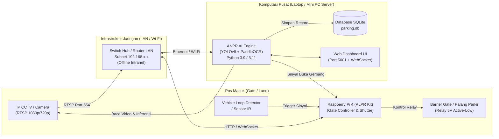

# DOKUMEN SPESIFIKASI TEKNIS (TECHNICAL SPECIFICATION)
## Sistem Monitoring Parkir & Deteksi Plat Nomor Otomatis (ANPR)

Dokumen ini memuat rincian spesifikasi teknis lengkap yang mencakup kebutuhan perangkat keras (*hardware*), konfigurasi jaringan (*network*), spesifikasi kamera pengawas (*CCTV/IP Camera*), serta arsitektur perangkat lunak (*software stack*) untuk implementasi sistem ANPR.

---

### 1. Topologi Arsitektur Sistem

Sistem beroperasi pada arsitektur **Hybrid Client-Server / Edge-Computing** dengan kapabilitas operasi **100% Offline (Tanpa Internet)**.

---

### 2. Spesifikasi Perangkat Keras (Hardware Specifications)

#### A. Unit Pemrosesan AI Utama (AI Processing Server / Laptop / PC)
Bertanggung jawab atas inferensi *Deep Learning* berat (deteksi kendaraan, lokalisasi plat nomor, ekstraksi karakter OCR, dan validasi aturan Samsat).

| Komponen | Spesifikasi Minimum | Spesifikasi Rekomendasi (Optimal) |
| :--- | :--- | :--- |
| **Prosesor (CPU)** | Intel Core i5 Gen 8 / AMD Ryzen 5 (4 Cores, 8 Threads) | Intel Core i7 Gen 11+ / AMD Ryzen 7 (8 Cores+) |
| **Memori (RAM)** | 8 GB DDR4 | 16 GB DDR4/DDR5 Dual-Channel |
| **Penyimpanan (Storage)** | 128 GB SSD (SATA / NVMe) | 256 GB NVMe SSD (M.2 PCIe) |
| **Akselerator Grafis (GPU)** | Terintegrasi (Intel UHD / Iris Xe / AMD Radeon) | NVIDIA GeForce GTX 1650 / RTX 3050 (4 GB VRAM)+ |
| **Antarmuka Jaringan** | Gigabit Ethernet (100/1000 Mbps) & Wi-Fi 802.11ac | Gigabit Ethernet RJ45 kabel UTP Cat6 |
| **Sistem Operasi** | Windows 10/11 (64-bit) atau Ubuntu 22.04 LTS (64-bit) | Ubuntu 22.04 / 24.04 LTS (64-bit x86_64) |
| **Konsumsi Daya** | ~45 - 65 Watt (Laptop / Mini PC) | ~65 - 120 Watt |

---

#### B. Unit Pengontrol Gerbang & Edge Controller (Raspberry Pi ALPR Kit)
Bertanggung jawab atas kontrol fisik palang parkir, pembacaan sinyal sensor kendaraan (*loop detector*), dan jembatan kamera lokal di gardu.

| Komponen | Parameter Spesifikasi | Keterangan |
| :--- | :--- | :--- |
| **Papan Induk (SBC)** | **Raspberry Pi 4 Model B** | Broadcom BCM2711, Quad-core Cortex-A72 @ 1.5 GHz |
| **Arsitektur Sistem** | **64-bit (`aarch64`)** | Wajib 64-bit (Raspberry Pi OS Bookworm / Bullseye) |
| **Memori (RAM)** | 4 GB / 8 GB LPDDR4-3200 SDRAM | Cukup untuk kontrol I/O, server Flask, dan buffer frame |
| **Media Penyimpanan** | MicroSD Card 32 GB / 64 GB Class 10 (UHS-I / U3) | Kecepatan baca $\ge 95$ MB/s, tulis $\ge 30$ MB/s |
| **Modul Antarmuka Palang** | Modul Relay 5V (1 Channel / 2 Channel Optocoupler) | *Active-Low trigger*, terhubung ke pin GPIO 17 / GPIO 27 |
| **Catu Daya (Power Supply)**| Adaptor USB-C 5.1V / 3.0A (15.3 Watt Official) | Stabil untuk mencegah *undervoltage* |
| **Pendingin (Cooling)** | Aluminium Heatsink + Mini Fan 5V Active Cooler | Menjaga suhu CPU $< 55^\circ\text{C}$ pada pemakaian 24/7 |

---

### 3. Spesifikasi Kamera Pengawas (Camera Specifications)

Sistem mendukung 2 skenario kamera: **Kamera IP CCTV (Standar Parkir)** dan **Webcam/CSI Camera (Testing & Prototyping)**.

#### A. Kamera CCTV IP Utama (Production Standard)
Digunakan pada tiang gerbang masuk/keluar untuk menangkap gambar kendaraan dan plat nomor dengan jarak tembak 3 – 5 meter.

| Parameter Teknis | Kebutuhan Spesifikasi | Contoh Model Referensi |
| :--- | :--- | :--- |
| **Tipe Kamera** | Fixed / Varifocal Bullet IP Camera (Outdoor IP67) | Hikvision DS-2CD2021G1, Dahua DH-IPC-HFW1230S |
| **Resolusi Sensor** | Full HD (1920 × 1080) @ 25/30 FPS atau 720p | Minimum 2.0 Megapixel CMOS progressive scan |
| **Protokol Streaming** | **RTSP** (`rtsp://`), ONVIF Profile S, HTTP ISAPI | Substream/Mainstream H.264 atau MJPEG |
| **Panjang Lensa (Focal)** | **4 mm / 6 mm** Fixed Lens (sudut pandang ~50° - 80°) | Fokus terpusat pada koridor kendaraan (*lane width* 2.5 - 3 m) |
| **Kecepatan Shutter** | $1/100 \text{ detik}$ s.d. $1/1000 \text{ detik}$ (Electronic Shutter) | Mencegah efek *motion blur* saat kendaraan bergerak masuk |
| **Pencahayaan Minimum** | $0.01\text{ Lux}$ @ (F1.2, AGC ON), $0\text{ Lux}$ with IR | Dilengkapi Smart IR LED (jangkauan minimum 15 - 30 meter) |
| **Kompensasi Cahaya** | True WDR ($120\text{ dB}$), BLC, 3D DNR | Meredam pantulan lampu utama mobil dan silau matahari |
| **Konektivitas Fisik** | Port RJ-45 10/100 Mbps (Mendukung PoE IEEE 802.3af) | Transmisi data & daya via kabel Ethernet tunggal |

#### B. Kamera Lokal Raspberry Pi (Prototype / Portable Kit)
| Parameter | Spesifikasi |
| :--- | :--- |
| **Jenis Sensor** | Raspberry Pi Camera Module V2 (Sony IMX219) atau USB Webcam HD |
| **Antarmuka** | Pita Pipih 15-pin MIPI CSI-2 atau USB 2.0 / 3.0 |
| **Resolusi Pengujian** | 640 × 480 @ 30 FPS s.d. 1280 × 720 @ 30 FPS |
| **Driver Linux** | V4L2 (`/dev/video0`), diaktifkan via `bcm2835-v4l2` |

---

### 4. Spesifikasi Jaringan & Komunikasi (Network Specifications)

Sistem dirancang mandiri dalam **Local Area Network (Intranet LAN)** tanpa ketergantungan koneksi internet publik.

#### A. Infrastruktur Jaringan
* **Topologi**: Star Topology terhubung ke Gigabit Switch / Router Pos Parkir.
* **Media Transmisi**: Kabel UTP/STP Cat5e / Cat6 (Maksimal 100 meter antar node) atau Wi-Fi 2.4 GHz / 5.0 GHz (WPA2-PSK).
* **Alokasi Pengalamatan (IP Addressing Plan)**:
  * Subnet: `192.168.110.0/24` (Subnet Mask `255.255.255.0`)
  * Gateway / Router: `192.168.110.1`
  * AI Server / Laptop: `192.168.110.52` (Static IP disarankan)
  * Raspberry Pi Controller: `192.168.110.7` (atau `192.168.13.118`)
  * IP Camera CCTV: `192.168.110.101` (Static IP)

#### B. Port & Protokol Komunikasi

| Layanan | Protokol / Port | Jalur Sumber $\rightarrow$ Tujuan | Fungsi |
| :--- | :--- | :--- | :--- |
| **Web Dashboard & API** | TCP / `5001` | Laptop / Client $\leftrightarrow$ AI Server | HTTP Dashboard, endpoint `/api/detect`, status parkir |
| **WebSocket Realtime** | WS / `5001` (`/ws`)| Browser Dashboard $\leftrightarrow$ AI Server | *Push update* frame video, bounding box, dan hasil OCR |
| **RTSP Video Feed** | TCP-UDP / `554` | CCTV $\rightarrow$ AI Server (Laptop) | Pengambilan video stream realtime untuk inferensi |
| **Camera Shutter / Stream** | TCP / `8080` & `5050`| AI Server $\leftrightarrow$ Raspberry Pi | Endpoint `/video_feed` (MJPEG) dan `/capture_image` |
| **Remote Maintenance** | TCP / `22` (SSH) | Laptop $\rightarrow$ Raspberry Pi | Akses terminal jarak jauh tanpa monitor terpisah |

---

### 5. Spesifikasi Perangkat Lunak (Software & AI Stack)

| Lapisan Sistem | Teknologi / Pustaka | Versi | Peran Teknis |
| :--- | :--- | :--- | :--- |
| **Bahasa Pemrograman** | Python | 3.9 / 3.11 / 3.13 (64-bit) | Bahasa inti backend dan pemrosesan AI |
| **Framework Deteksi Objek** | **Ultralytics YOLOv8** | $\ge 8.0$ | Deteksi kendaraan (Car, Motorcycle, Bus, Truck) & Plat Nomor |
| **Model Detektor Plat** | Custom Trained YOLOv8n/s | Custom `.pt` | Lokalisasi bounding box plat nomor standar Indonesia |
| **Mesin Pembaca Karakter** | **PaddleOCR (PaddlePaddle)** | $\ge 2.6$ | Ekstraksi karakter plat (*Single-pass*, font timbul/putih/hitam) |
| **Validasi Aturan Samsat** | Custom Regex Engine | Proprietary | Normalisasi format Indonesia (Kop Daerah, 1-4 Angka, Seri Huruf) |
| **Server Web & API** | Flask, Flask-CORS, Flask-Sock | Flask 2.x/3.x | Routing HTTP REST API dan server WebSocket |
| **Computer Vision Engine** | OpenCV (`cv2`) | $\ge 4.5$ | Akuisisi stream RTSP/MJPEG, rotasi, cropping, dan color space |
| **Basis Data Relasional** | SQLite 3 | Bawaan Python | Penyimpanan log kendaraan masuk, jam masuk/keluar, dan tarif |
| **Frontend Dashboard** | HTML5, CSS3, JavaScript ES6 | Standalone | Tampilan monitoring gerbang, status koneksi, dan cetak tiket |

---

### 6. Indikator Kinerja Sistem (Key Performance Indicators)

* **Kecepatan Inferensi Total (End-to-End Latency)**: $< 0.8\text{ detik}$ (Target operasional gerbang parkir: $< 1.0\text{ detik}$).
* **Akurasi Pembacaan Plat Nomor Indonesia**: $\ge 92\% - 96\%$ pada kondisi pencahayaan normal ($\ge 20\text{ Lux}$).
* **Ketersediaan Sistem (Uptime)**: $99.9\%$ berkat mode operasional **100% Offline** (tidak terpengaruh putusnya koneksi internet luar).
